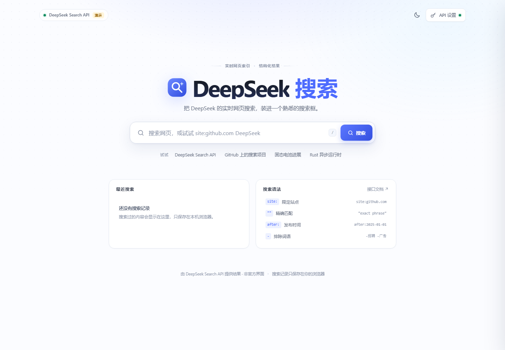
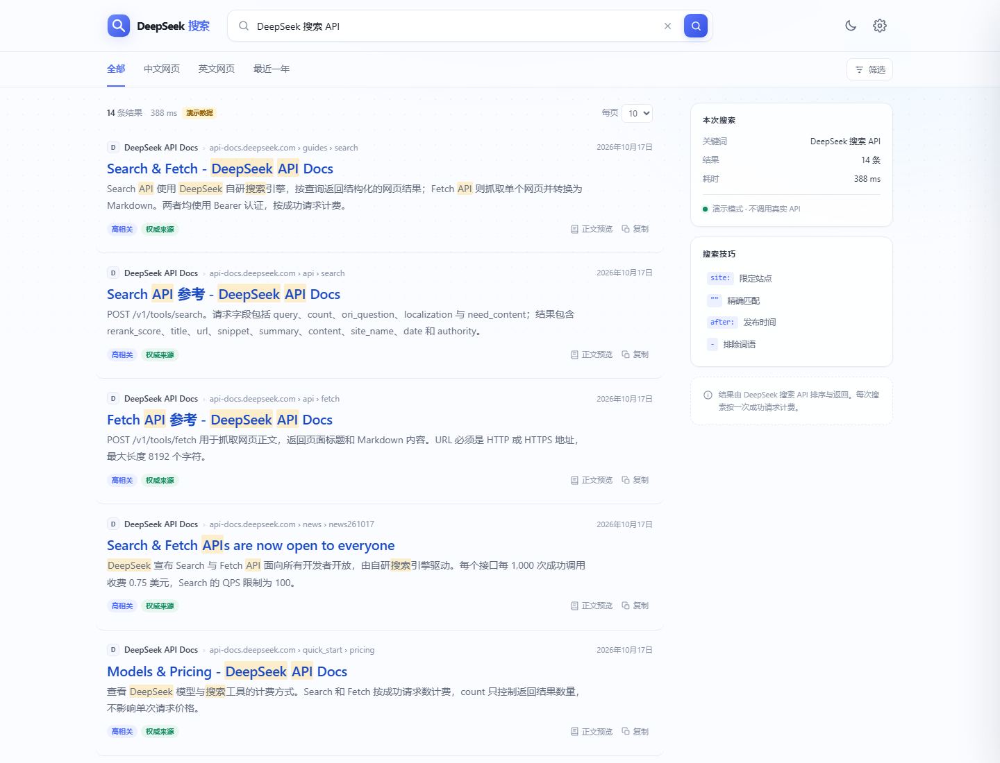

# DeepSeek Search UI

[](LICENSE)
[](https://nodejs.org/)

> **Unofficial project.** Not affiliated with, endorsed by, or sponsored by DeepSeek.
>
> 一个面向 **DeepSeek Search & Fetch API** 的非官方搜索界面。

DeepSeek Search UI 把搜索 API 包装成熟悉的传统搜索引擎体验：大搜索框、结果列表、站点图标、摘要、发布时间、分页、筛选、搜索历史和网页正文预览。

- 前端：原生 HTML / CSS / JavaScript，无构建步骤
- 后端：Node.js 原生 `http` 模块，零第三方运行时依赖
- 上游：`POST /v1/tools/search` 与 `POST /v1/tools/fetch`
- API Key 只留在本地 Node 服务，不会下发到浏览器

截图使用内置演示数据，不包含真实用户信息。





更多截图：[移动端首页](docs/mobile-home.png) · [移动端结果页](docs/mobile-results.png) · [正文预览](docs/preview.png) · [深色模式](docs/dark.png)

## 为什么做这个

DeepSeek 在 2026 年 10 月开放 Search / Fetch API。开发时调研 GitHub，现有生态大多是把联网搜索接进聊天机器人或 Agent 的插件，例如 [LibreChat](https://github.com/LibreChat-AI/LibreChat)、[AingDesk](https://github.com/aingdesk/AingDesk)、[dsh-web-search-pro](https://github.com/anweat/dsh-web-search-pro) 和 [modsearch](https://github.com/liustack/modsearch)。

这个项目不尝试做另一个聊天壳，而是只回答一个问题：**如果 DeepSeek 的搜索结果出现在一个传统搜索引擎页面里，会是什么样？**

## 功能

- **搜索结果页**：结果数、耗时、标题、站点图标、面包屑 URL、摘要、发布时间
- **相关性提示**：`rerank_score >= 1.5` 显示“高相关”，`authority >= 3` 显示“权威来源”
- **搜索语法**：`site:`、`-site:`、`"精确短语"`、`lang:`、`after:`、`before:`、排除词
- **筛选面板**：站点、语言、发布时间、排除词，自动拼成 DeepSeek 查询
- **本地分页**：一次请求 30 条，每页 10 / 20 / 30 条
- **正文预览**：调用 Fetch API 抓取网页，在侧边抽屉中阅读 Markdown
- **搜索历史**：最近 8 条，只保存在浏览器 `localStorage`
- **API Key 设置**：页面内填写，只存在当前 Node 进程内存；也可用 `.env` 持久化
- **深色模式与响应式布局**：桌面、平板、手机均可用
- **演示模式**：没有 Key 也能先体验界面
- **中文错误提示**：401 / 402 / 403 / 404 / 429 / 超时 / 网络错误

## 快速开始

要求：**Node.js 20+**。不需要 `npm install`，项目没有第三方依赖。

下载或 clone 项目后，在项目目录运行：

```bash
cd deepseek-search-ui
npm start
# 或直接运行
node server.mjs
```

> Windows PowerShell 如果提示禁止运行 `npm.ps1`，可以直接用 `node server.mjs`，或改用 `npm.cmd start`。

然后打开：

```text
http://127.0.0.1:5178
```

Windows 也可以双击 `start.cmd`。

首次启动后，点击右上角 **API 设置**，填入 DeepSeek API Key。页面内填写的 Key 只保存在当前服务进程内，重启服务后需要重新填写。

### 没有 Key，先看界面

```bash
npm run demo
```

演示模式使用内置结果，**不会调用真实 API**，页面会显示“演示数据”标记。

### 使用 `.env` 持久化 Key

复制 `.env.example` 为 `.env`：

```bash
cp .env.example .env
```

Windows PowerShell：

```powershell
Copy-Item .env.example .env
```

编辑 `.env`：

```dotenv
DEEPSEEK_API_KEY=sk-your-key-here
```

保存后重启 `npm start`。`.env` 已被 `.gitignore` 忽略，不要提交到仓库。

## 配置

| 变量 | 默认值 | 说明 |
| --- | --- | --- |
| `DEEPSEEK_API_KEY` | 空 | DeepSeek API Key；也可以在页面中配置 |
| `PORT` | `5178` | 本地服务端口 |
| `HOST` | `127.0.0.1` | 监听地址，默认仅本机 |
| `DEMO_MODE` | `0` | 设为 `1` 使用内置演示数据 |
| `DEEPSEEK_API_BASE` | `https://api.deepseek.com` | 调试或代理用的 API 地址 |

> 不要把 `HOST` 改成 `0.0.0.0` 后直接暴露到公网。这个服务会使用你的 API Key 代理搜索请求，并且没有多用户鉴权。

## 工作方式

```text
Browser
  │  POST /api/search  { query, count, ori_question }
  ▼
Local Node server  ──Bearer Key──▶  https://api.deepseek.com/v1/tools/search
  │  POST /api/fetch  { url }
  └───────────────────────────────▶  https://api.deepseek.com/v1/tools/fetch
```

- 浏览器只与本地 Node 服务通信，API Key 不会出现在前端 JavaScript、页面 HTML 或 `localStorage` 中。
- 所有 POST 接口强制 `Content-Type: application/json`，避免跨站简单请求滥用本地 Key。
- 只有本机回环地址可以调用 `POST /api/key` 设置或清除 Key。
- 搜索请求固定请求 30 条结果，分页在浏览器内完成；Search API 本身没有 offset 参数。
- 服务端不缓存搜索结果，也不把查询写入磁盘；每次搜索都会请求一次 API。
- Fetch 返回的 Markdown 会先转义再渲染，不执行网页里的 HTML 或脚本。

### Search API

```http
POST https://api.deepseek.com/v1/tools/search
Authorization: Bearer <DEEPSEEK_API_KEY>
Content-Type: application/json

{
  "query": "DeepSeek site:github.com lang:zh after:2025",
  "count": 30,
  "ori_question": "DeepSeek 搜索"
}
```

界面用到的主要字段：

| 字段 | 用途 |
| --- | --- |
| `title` | 结果标题 |
| `url` | 标题链接、面包屑 |
| `snippet` | 结果摘要 |
| `site_name` / `site_icon` | 站点名、favicon |
| `date` | 发布时间 |
| `authority` | “权威来源”标记（≥ 3） |
| `rerank_score` | “高相关”标记（≥ 1.5） |

### Fetch API

点击结果下方的“正文预览”时：

```http
POST https://api.deepseek.com/v1/tools/fetch
Authorization: Bearer <DEEPSEEK_API_KEY>
Content-Type: application/json

{ "url": "https://example.com/article" }
```

Fetch 是否成功取决于目标站点的访问策略；失败时会保留“打开原文”链接。

### 搜索语法

| 语法 | 示例 | 作用 |
| --- | --- | --- |
| `site:` | `site:github.com` | 限定站点 |
| `-site:` | `-site:example.com` | 排除站点 |
| `"..."` | `"exact phrase"` | 精确短语 |
| `lang:` | `lang:zh,en` | 限定语言 |
| `after:` | `after:2025` | 发布时间晚于 |
| `before:` | `before:2026-06-01` | 发布时间早于 |
| `-` | `-招聘` | 排除词语 |

完整语法与计费规则以 [DeepSeek Search & Fetch 文档](https://api-docs.deepseek.com/guides/search) 为准。

## 项目结构

```text
deepseek-search-ui/
├─ server.mjs              # 零依赖 Node 服务：静态文件 + API 代理 + 演示数据
├─ public/
│  ├─ index.html           # 页面结构
│  ├─ styles.css           # 视觉与响应式
│  ├─ app.js               # 搜索、筛选、分页、预览、设置等交互
│  ├─ theme-init.js        # 首屏前应用主题，避免闪白
│  └─ favicon.svg
├─ docs/                   # README 截图
├─ .github/workflows/ci.yml
├─ .env.example
├─ LICENSE
├─ SECURITY.md
├─ start.cmd
├─ package.json
└─ README.md
```

## 开发与测试

```bash
npm test          # node --check server.mjs && node --check public/app.js
npm run demo      # 启动演示服务
npm run dev       # Node --watch 开发模式
```

CI 会在 Node.js 20 / 22 / 24 上运行语法检查，并用演示模式做一次 `/api/config`、`/api/search`、`/api/fetch` 冒烟测试。**CI 不调用真实 API，也不需要 API Key。**

## 部署

GitHub Pages 不能运行这个项目，因为它需要 Node 服务端来隐藏和代理 API Key。

- **本地使用**：直接 `npm start`，这是推荐方式。
- **公开演示**：部署到能运行 Node 的平台（Render、Fly.io、Railway、VPS 等），并在部署环境里设置 `DEEPSEEK_API_KEY`。
- **公网部署前**：当前 `/api/search` 对任何访问者开放，必须增加访问鉴权、限流和额度控制，否则别人可以消耗你的 API 余额。
- `/api/key` 只允许本机调用，所以服务器部署应使用环境变量注入 Key，而不是网页设置。

### 费用提醒

Search 与 Fetch 按成功请求计费（文档目前为 **$0.75 / 1,000 次**），与返回条数无关。公开演示前请先估算调用量并设置限额；最新价格以官方文档为准。

## 隐私与安全

- 搜索词会发送给 DeepSeek API；浏览器中的搜索历史只用于回填搜索框。
- 页面内填写的 Key 只存在 Node 进程内存；`.env` 是明文文件，请注意本机权限。
- 服务端日志只记录结果数量和耗时，不记录完整查询词或网页 URL。
- 没有第三方统计、分析脚本或外部字体。
- 站点图标由浏览器直接向搜索结果提供的域名请求，可能向对应站点暴露你的 IP。
- Fetch 内容按 Markdown 转义渲染，不执行原始 HTML 或脚本。

如果你发现安全问题，请阅读 [SECURITY.md](SECURITY.md)，不要在公开 issue 中粘贴 API Key 或敏感日志。

## 已知限制

- Search API 单次最多返回 50 条，且没有 offset；本项目请求 30 条后本地分页，不能继续翻到第 31 条之后。
- 不做 AI 摘要、答案生成或重写，只呈现搜索结果，不额外调用 Chat Completions。
- Fetch 可能被目标站点拒绝，或页面没有可提取正文。
- 没有服务端缓存；同一个词再次搜索会再次调用 API，会计费。
- 没有内置 HTTP 代理支持；如需代理，需要自行配置 Node 的 `fetch`。
- 这是一个单用户本地工具，不是多租户搜索服务。

## 贡献

欢迎 issue 和 pull request。提交前请注意：

1. 运行 `npm test`。
2. 使用 `npm run demo` 验证界面，不要在测试中调用真实 API。
3. 不要提交 `.env`、API Key、查询日志或含个人信息的截图。
4. 改动 UI 时，请同步检查桌面和移动端布局。

## License

[MIT](LICENSE) © 2026 The deepseek-search-ui authors

DeepSeek 名称、API 与相关内容的权利归其所有者。本项目是非官方项目，不代表 DeepSeek 官方立场。
